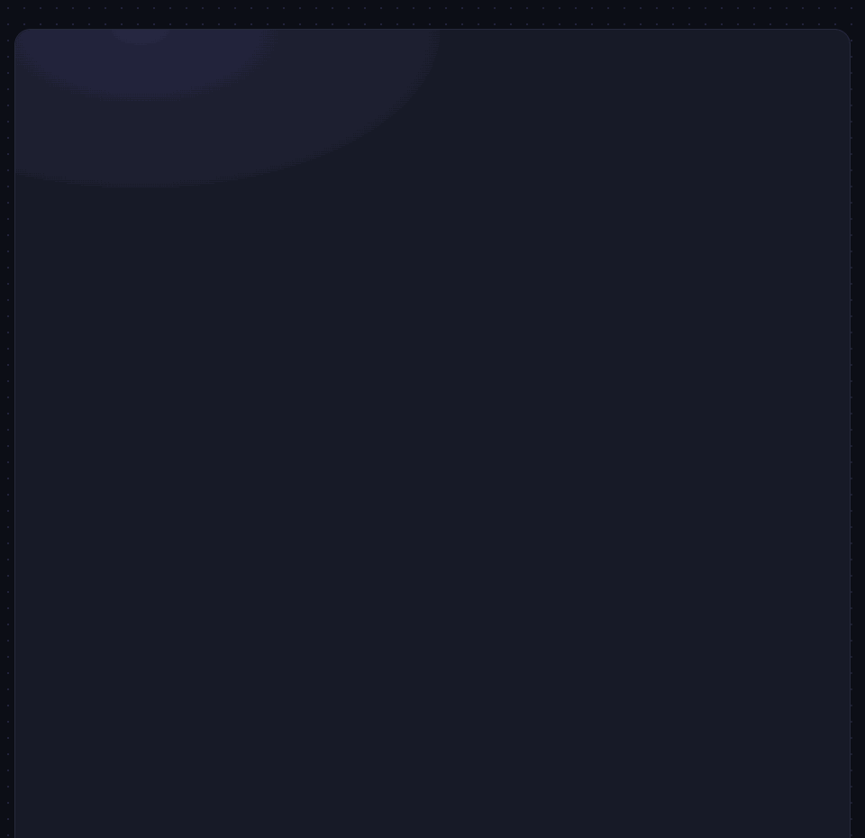

# cursorcrew



Your page, built live by a crew of multiplayer cursors.

Point it at any element. It blanks the content, then a crew of named cursors draws every box, types every line and drops in every image until the real page is back. Zero dependencies, about 8 KB gzipped.

```bash
npm i @bokijonovm/cursorcrew
```

## Usage

```js
import { assemble } from '@bokijonovm/cursorcrew';

const crew = assemble('#app', {
  agents: 5,
  duration: 8,
  trigger: 'viewport',
});

await crew.finished;
```

To avoid a flash of the finished page before the script runs, mark the target as pending and hide it in your CSS:

```html
<style>[data-assemble-pending]{visibility:hidden}</style>
<main id="app" data-assemble-pending>…</main>
```

### React

```jsx
import { Assemble } from '@bokijonovm/cursorcrew/react';

export default function Hero() {
  return (
    <Assemble as="section" options={{ agents: 4 }}>
      <h1>Hello world</h1>
    </Assemble>
  );
}
```

There is also a hook, `useAssemble(ref, options)`, which returns a ref holding the crew. Options are read on mount; change the component's `key` to rebuild with new ones. The React entry is marked `"use client"`, so it works in Next.js App Router.

### CDN

```html
<script src="https://cdn.jsdelivr.net/npm/@bokijonovm/cursorcrew@0.1.0/dist/cursorcrew.global.js"></script>
<script>
  CursorCrew.assemble('#app');
</script>
```

## Options

| Option | Default | What it changes |
| --- | --- | --- |
| `agents` | `5` | How many cursors (1–24), or a list of `{ name, color }` |
| `duration` | natural | Fit the whole build into this many seconds |
| `speed` | `1` | Playback speed when `duration` is not set |
| `trigger` | `'immediate'` | `'viewport'` waits until the target scrolls into view |
| `autoplay` | `true` | Set `false` and call `crew.play()` yourself |
| `typing` | `'auto'` | `'char'`, `'word'`, or `'auto'` (letters for short text, words for long) |
| `maxTasks` | `250` | Cap on animated pieces; the smallest nested ones merge into their parent |
| `cleanup` | `true` | Remove the overlay and restore inline styles when done |
| `labels` | `true` | Show cursor name tags |
| `actions` | `true` | Show what each cursor is doing next to its name |
| `zIndex` | `2147483000` | z-index of the overlay |
| `reducedMotion` | `'respect'` | `'respect'` skips the animation for `prefers-reduced-motion`; `'ignore'` always plays |
| `onStart`, `onProgress(p)`, `onComplete` | | Lifecycle callbacks; `p` goes from 0 to 1 |

### Attributes

| Attribute | Effect |
| --- | --- |
| `data-assemble="skip"` | Leave this element and its children alone |
| `data-assemble="block"` | Reveal this element as one piece instead of building its insides |
| `data-assemble-pending` | Hidden until the crew starts (add the CSS rule above) |

## The crew object

```ts
interface Crew {
  timeline: Timeline;      // play(), pause(), progress(), timeScale(), duration()
  finished: Promise<void>; // resolves when the build ends or is destroyed
  play(): void;
  pause(): void;
  finish(): void;          // jump to the end
  replay(): void;          // reset and build again
  destroy(): void;         // stop and restore the element as it was
}
```

## How it works

1. **Scan.** The target is walked once. Anything that paints a surface (fill, border, shadow) becomes a box; text becomes a typing task; images, SVG, video and canvas become media.
2. **Schedule.** The cursor that is free soonest takes the nearby task it can start earliest. Children wait for their parent box, so work spreads across the page in reading order.
3. **Play.** A small built-in timeline drives everything with `requestAnimationFrame`. Cursors and boxes move with `translate3d`, so they stay on the GPU. When a tab stalls, playback resumes where it was instead of jumping ahead.
4. **Restore.** When the build finishes, inline styles and text nodes go back exactly as they were.

## Browser support

All evergreen browsers. Draw-box tints use `color-mix()` (Chrome 111, Safari 16.2, Firefox 113). Text is split by grapheme with `Intl.Segmenter` where available, so emoji type as one character.

## Development

```bash
npm install
npm test          # vitest + jsdom
npm run build     # dist/: ESM, CJS, types, and the CDN bundle
```

Open `demo/index.html` after building to see the full demo.

### Releasing

```bash
npm version patch   # or minor / major
npm publish         # runs typecheck, tests, build and package checks first
git push --follow-tags
```

## License

MIT © [Muhsinjon Bokijonov](https://www.bokijonov.com/)
